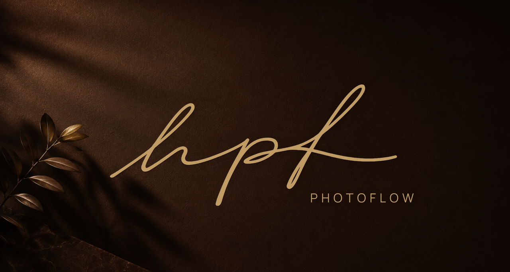
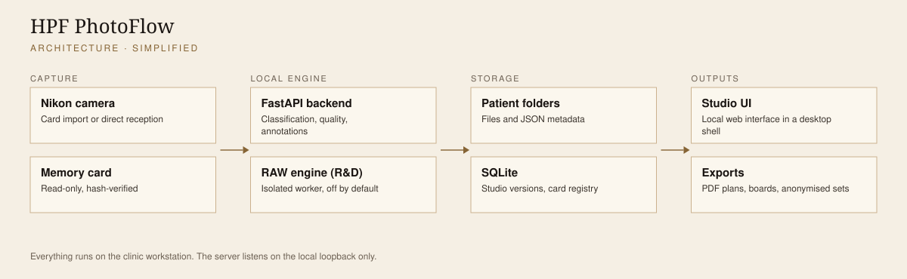

# HPF PhotoFlow

> Clinical photography without friction: from the Nikon camera to a classified, annotated protocol.

**Status** · In use &nbsp;·&nbsp; **Area** · Clinical & Patient Experience &nbsp;·&nbsp; **Source code** · private, documentation only

### At a glance

- Every shot filed under the right patient and view, never guessed.
- Originals never modified; annotations stay separate layers.
- Runs entirely on the clinic workstation, no cloud.

## The problem

Clinical photos end up scattered across memory cards, folders and the camera maker's software.  
Building a complete, correctly attributed photo protocol takes time, and a photo filed under the wrong patient is worse than a lost one.  

## The solution

A fully local clinical photo assistant that files each shot under the right patient and view, then produces annotated boards and anonymised exports.

## My role

Product design and development.  
The project started from clinical photography at the dental chair.

## Key features

- Capture classified by protocol (12-view clinical series, 6-view whitening series); unrecognised photos go to an unassigned area, never to a guessed patient.
- Memory card import: read-only card, SHA-256 verified copy, atomic write, duplicate detection.
- Direct reception from the camera over its built-in transfer function.
- Deterministic, explainable technical quality control (blur, exposure), never blocking.
- Non-destructive annotations stored as overlays, never burned into the original.
- Studio: versions, trash, editing and a treatment-plan editor with PDF export.
- Two exports: clinical, and communication with local face detection to blur the eyes.

## Screenshots

No screenshot is published: every real screen of this tool would show clinical or case data.  
The simplified architecture below shows how it is built.

## Technologies

Python · FastAPI · Pillow · NumPy · ONNX Runtime · WeasyPrint · SQLite · PyInstaller

## Architecture

- Python backend with a vanilla HTML and JavaScript front end, packaged as a Windows desktop application with an installer.
- Versions are pinned, including transitive dependencies, with a software bill of materials.
- Nikon RAW engine (research branch): the camera maker's SDK runs in an isolated process so a crash cannot take down the application; RAW files are verified unchanged before and after.

## Development status

- Version 1.7.0-rc.20 installed and in use on the clinic workstation.
- Test matrix of 297 test scripts; the last fully green CI run covered 285 scripts and 7,691 assertions.
- Nikon RAW engine: R&D prototype, about 6.75 s per RAW file on the bench, byte-identical re-renders, colour fidelity not measured and not claimed.
- Real hardware acceptance tests of the RAW engine and of the iPhone sync are still to do.

## Privacy and code availability

- No cloud: data stays on the workstation, originals are never modified.
- The private repository ignores every file by default, so a patient case cannot be committed by mistake.
- Anonymised export blurs the eyes, and the documentation states it is not an absolute guarantee.
- Optional iPhone sync is encrypted, paired by single-use code and locked by default.
- The source code of HPF PhotoFlow is proprietary and kept in a private repository.
- This repository contains documentation and demonstration screenshots only.
- Demonstrations can be arranged on request.

---

[Hugo Philippe Fusaro](https://github.com/hugophilippefusaro) · [HPF Dental Solutions](https://github.com/hpfdentalsolutions) · [hpfdentalsolutions.com](https://hpfdentalsolutions.com)  
© 2026 Hugo Philippe Fusaro. All rights reserved on texts and images.
